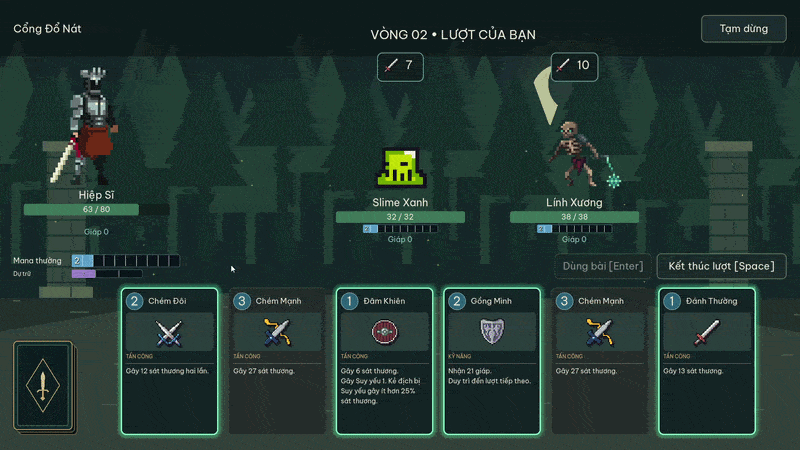

# Game thẻ bài

Game thẻ bài theo lượt (Turn-based card game), viết bằng Godot 4.7 và GDScript. 

Xây dựng một bộ bài thích hợp về vào khu rừng và hạ gục boss của khu rừng tối. Tận dụng nguồn mana cẩn thận để cân bằng tấn công và phòng thủ. 

## Tải và chạy dự án

1. Tải toàn bộ mã nguồn dưới dạng ZIP rồi giải nén, hoặc clone kho mã nguồn.
2. Mở **Project Manager** của Godot, chọn **Import** và tìm đến file `project.godot`.
3. Mở dự án và đợi Godot nhập hình ảnh, âm thanh.
4. Nhấn **F5 / Run Project** để chơi thử.

# Cách game hoạt động

## 1. Luật chơi cơ bản
### Khời đầu
- Bộ bài khởi đầu cần đúng **20 lá**, tối đa **5 bản sao mỗi loại**. Cần một lá giá 1 mana và một lá khác giá không quá 3. Bạn có thể dùng bộ bài được xây sẵn hoặc tự xây một bộ bài riêng.
- Khi bắt đầu, bạn sẽ chọn 5 lá trong bộ bài mà có thể chọn để giữ hoặc đổi lấy một lá khác. Sau mỗi lượt, sẽ được bốc thêm một lá.

### Lá bài
- Mỗi lượt bạn sẽ được đi trước và có thể dùng mana để chơi các thẻ bài để tấn công địch hoặc phòng thủ bản thân
- Có 2 loại thẻ cơ bản: Lá **Attack** (Tấn công) dùng mana thường, và lá **Skill** (Kĩ năng) dùng dự trữ trước, rồi đến mana thường.
- **Để chơi một lá**, kéo thẻ ra khỏi vùng bài để dùng; thả lại vào vùng bài để hủy. **Enter** chơi lá đã chọn, **Space** kết thúc lượt.
- Các lá **Attack** có thể kéo đến kẻ địch để tấn công họ (Trừ máu dựa theo sát thương từng lá), lá có giá mana càng cao sẽ gây càng nhiều sát thương.
- Các lá **Skill** gồm những lá còn lại có thể cho phòng thủ, sức mạnh, làm suy yếu kẻ địch hay giúp tăng mana hoặc bốc thêm lá.

### Các hiệu ứng
- Có các hiệu ứng khác nhau như: **Block** (Phòng thủ) chặn sát thương của kẻ địch, **Strength** (Sức mạnh) tăng sát thương mỗi cú đánh. **Weak** (Suy yếu) giảm 25% sát thương.

### Hệ thống mana
- **Mana** thường sẽ được nạp theo vòng: 1, 2, 3… tối đa đến 10. Nếu trong một lượt không dùng hết lượng mana thường, chúng sẽ chuyển thành mana dự trữ chứa, tối đa 3 mà sẽ mang theo lượt sau.

### Kẻ địch
- Mỗi lượt kẻ địch sẽ hiện ý định của họ: Tấn công, phòng thủ, hoặc dùng kĩ năng đặc biệt. Nhấp chuột phải vào kẻ địch hoặc ô ý định của họ để xem chi tiết. Hoặc nhấp chuột phải vào lá bài để đọc kĩ thông tin hơn. 

## 2. Cấu trúc code

| Thành phần | Vai trò |
| --- | --- |
| [scripts/ui/game.gd](scripts/ui/game.gd) | Nạp nội dung, chuyển màn hình, mở chiến dịch và quản lý cài đặt. |
| [scripts/services/content.gd](scripts/services/content.gd) | Đọc catalog và chiến dịch, tra ID, kiểm tra cấu hình và bộ bài. |
| [scripts/combat/combat.gd](scripts/combat/combat.gd) | Luật mana, rút/xáo bài, sát thương, lượt địch và thắng/thua. |
| [scripts/ui/combat_screen.gd](scripts/ui/combat_screen.gd) | Nhận thao tác của người chơi và gửi lệnh cho `Combat`. |
| [scripts/ui/combat_presenter.gd](scripts/ui/combat_presenter.gd) | Đọc sự kiện để hiển thị kết quả. |
| [scripts/run/demo_run.gd](scripts/run/demo_run.gd) | Giữ máu, bộ bài, trận hiện tại và phần thưởng của chiến dịch. |
| [data/card_catalog.tres](data/card_catalog.tres) | Tổng hợp tất cả các thẻ được đăng ký và bộ bài mặc định. |
| [data/campaigns/demo.tres](data/campaigns/demo.tres) | Chiến dịch mặc định, tham chiếu các trận trong `data/encounters/`. |

Luồng xử lý: **UI → Combat → cập nhật trạng thái và phát sự kiện → CombatPresenter → UI**. Sửa luật trong model hoặc resource hiệu ứng, không đặt luật gây sát thương vào callback hoạt ảnh.

Âm thanh chiến đấu được phát theo các sự kiện này. Để đổi tiếng chém, trúng đòn, phòng thủ, hồi máu hoặc hiệu ứng trạng thái, mở `game.tscn`, chọn node **Audio → Combat Sounds** và kéo file âm thanh vào trường tương ứng. Tất cả dùng mức âm lượng **Hiệu ứng âm thanh** trong cài đặt.

### Thẻ bài

[CardDefinition](scripts/data/card_definition.gd) là `Resource`, lưu thành `.tres` trong `data/cards/`. Nó chứa ID, tên, giá mana, loại, mục tiêu, hình ảnh, mô tả và hiệu ứng. Thẻ trong trận, thư viện và phần thưởng cùng dùng resource này.

Mõi thẻ sẽ có thể chứa các [CombatEffect](scripts/data/effect.gd) (Hiệu ứng) hỗ trợ `damage`, `block`, `draw`, `mana`, `heal`, `weak`, `strength`, `interrupt`. Các phần tử trong `effects` chạy theo thứ tự. `recipient = source` áp dụng lên người dùng thẻ; `targets` áp dụng lên mục tiêu đã chọn.

`CardDefinition` là dữ liệu dùng chung. Mỗi bản sao trong trận có `CardInstance` riêng. Không ghi trạng thái tạm của một lá lên resource vì các bản sao khác cũng tham chiếu nó.

### Nhân vật và kẻ địch

Địch là scene kế thừa [enemy.tscn](scenes/actors/enemies/enemy.tscn), dùng [EnemyActor](scripts/actors/enemy.gd). Người chơi kế thừa [player.tscn](scenes/actors/hero/player.tscn). Chúng cùng dùng `BattleActor` và có `AnimatedSprite2D` riêng.

Node gốc giữ thông tin thiết kế: máu tối đa, tấn công, phòng thủ, hoạt ảnh và kỹ năng. `build_definition()` tạo `ActorDefinition` khi bắt đầu trận. `ActorState` giữ máu hiện tại, giáp, mana, trạng thái và hồi chiêu của từng cá thể. Hai Slime dùng cùng scene vẫn có trạng thái riêng.

Kỹ năng địch nằm trong [data/enemies skill](<data/enemies skill>). `EnemySkill` chứa tên, icon, mô tả, mana, hồi chiêu, mục tiêu và hiệu ứng. Địch chỉ chọn kỹ năng đủ mana và đã hồi; kỹ năng giá cao có trọng số chọn lớn hơn. Không có khóa kỹ năng theo vòng đầu tiên.

## 3. Tạo và đưa nội dung mới vào game

### Tạo một lá bài

1. Nhân bản `.tres` gần với ý tưởng của bạn trong `data/cards/`, chẳng hạn [guard.tres](data/cards/guard.tres). Đặt tên file dễ hiểu, ví dụ `stone_guard.tres`.
2. Chọn resource trong FileSystem. Đổi `resource_name`, `id`, `title`, `cost`, `kind`, `hero_class`, `target`, `artwork` và `rules` trong Inspector. **ID phải duy nhất**. Giữ ID khi chỉ đổi tên lá đã có để bộ bài lưu vẫn nhận ra nó.
3. Sửa mảng `effects`. Nếu dùng lại resource hiệu ứng rồi muốn sửa riêng, chọn **Make Unique** trước để không đổi hiệu ứng của thẻ gốc.
4. Thêm bản dịch tên và mô tả vào `localization/text.csv` như hướng dẫn bên dưới.

Ví dụ lá phòng thủ: `cost = 2`, `kind = Skill`, `target = self`; thêm `CombatEffect` với `operation = block`, `amount = 15`. Đặt `rules = Gain 15 Block.`. Muốn rút thêm bài, thêm hiệu ứng thứ hai `operation = draw`, `amount = 1` rồi cập nhật mô tả.

Các mục tiêu hiện có: `enemy` (một địch), `self` (bản thân), `all_enemies` (mọi địch sống). Để tạo bài trên tay, dùng [CreateCardEffect](scripts/effects/create_card.gd), chọn resource ở `card` và số lượng ở `copies`. Thẻ được tạo cũng xuất hiện trong phần xem chi tiết nhờ `referenced_cards()`.

Nếu hiệu ứng có sẵn chưa đủ, tạo script `extends CombatEffect`, ghi đè `apply(combat, source, targets, context)`. Dùng hàm của `Combat` như `deal_damage()`, `gain_block()`, `draw_cards()` để trạng thái và sự kiện hiển thị cùng được cập nhật. Xem `create_card.gd` làm ví dụ; không cần sửa cả hệ thống thẻ.

### Cho thẻ xuất hiện trong thư viện và phần thưởng

1. Mở [data/card_catalog.tres](data/card_catalog.tres), tăng kích thước mảng **Cards**, kéo `.tres` mới vào một ô. Mỗi ID chỉ đăng ký một lần; đặt file vào thư mục chưa đủ.
2. Trên resource thẻ, mở nhóm **Availability**:

| In Library | In Rewards | Kết quả |
| --- | --- | --- |
| Bật | Bật | Có trong thư viện và danh sách phần thưởng mặc định. |
| Bật | Tắt | Chỉ có trong thư viện. |
| Tắt | Bật | Chỉ nhận qua phần thưởng; không thêm vào bộ bài khởi đầu. |
| Tắt | Tắt | Không xuất hiện ở hai nơi trên; dùng cho bài tạo bởi hiệu ứng. |

Thư viện và phần thưởng hiện nhận thẻ `Shared` hoặc `Knight`, vì game mới có một nhân vật. Thẻ thưởng được chọn đều giữa các loại hợp lệ, không dựa trên độ hiếm hay giá mana. Loại đã đủ 5 bản sao trong bộ bài bị loại khỏi phần thưởng. `In Rewards` vẫn phải bật khi dùng danh sách thưởng riêng của một trận.

Muốn đổi bộ bài mặc định, sửa **Starting Deck** trong catalog: kéo lặp lại cùng resource để thêm bản sao. Bộ bài cần thỏa giới hạn ở phần 1. Thay đổi này không ghi đè các bộ bài người chơi đã lưu.

Node gốc của `game.tscn` có trường **Content → Card Catalog** để chọn catalog khác. Tham chiếu resource trực tiếp giúp Godot đóng gói thẻ khi xuất bản; không cần thêm lệnh `preload` trong code.

### Tạo kẻ địch hoặc boss mới

1. Nhấp phải [enemy.tscn](scenes/actors/enemies/enemy.tscn), chọn **New Inherited Scene**, lưu tên mới vào `scenes/actors/enemies/`.
2. Trên node gốc, đặt `actor_key` duy nhất, thêm các mục cơ bản như: `display_name`, `description`, `max_health`, `attack`, `defense`. Chọn **Artwork → Artwork** cho thẻ xem chi tiết, độc lập với hoạt ảnh chiến đấu.
3. Gán `SpriteFrames` vào `Visuals/Art/AnimatedSprite2D`. Dùng các tên như `idle`, `attack`, `cast`, `hurt`, `death` để cho hoạt ảnh cho kẻ địch; kỹ năng có thể chỉ định clip riêng qua `animation`. Chọn **Make Unique** trước khi sửa riêng SpriteFrames dùng chung.
4. Giữ hoặc thay `basic_attack`, `basic_block`. Kéo resource kỹ năng vào **Special Actions**. Bật `is_boss` nếu đây là trùm.
5. Thêm tên/mô tả của địch và kỹ năng, rồi kéo scene vào **Enemies** của encounter như phần dưới. 

#### Kĩ năng của định
Kỹ năng sát thương dùng `EnemyDamageSkill`: `attack_multiplier` nhân đòn tấn công cơ bản, `flat_damage` cộng thêm sát thương, `hits` là số lần đánh. Ví dụ: Kĩ năng đánh hai lần sát thương cơ bản: multiplier 1, flat 0, hits 2. Tương tự kỹ năng giáp dùng `EnemyBlockSkill`, với `block_multiplier` và `flat_block`.

Đặt `id`, `title`, `kind`, `cost`, `cooldown`, `icon`, `description` cho kỹ năng. Mỗi kỹ năng kẻ địch sẽ có giá mana: Đến lượt 4, người chơi có 4 mana -> Kẻ địch cũng sẽ có 4 mana. Kẻ địch có thể dùng lượng mana đó để dùng kĩ năng đặc biệt thay vì chỉ tấn công hoặc phòng thủ. Sau khi dùng kĩ năng, họ sẽ phải đợi số lượt `cooldown` (Hồi chiêu), trước khi có thể dùng lại kĩ năng đấy lần nữa.

Kỹ năng riêng có thể `extends EnemySkill`; xem [enemy_interrupt_skill.gd](scripts/data/enemy_interrupt_skill.gd) cho phản ứng ngắt bài. Quy tắc riêng xuyên suốt trận dùng `extends ActorBehavior`, gán vào `behavior` của địch. Lưu bộ đếm trong `ActorState.memory`, không lưu trên resource dùng chung.

### Tùy chỉnh chiến dịch

1. Mở [data/campaigns/demo.tres](data/campaigns/demo.tres), hoặc nhân bản thành chiến dịch mới. `CampaignDefinition` có **Title**, **Encounters**, **Completion Text**.
2. Tạo resource `EncounterDefinition` trong `data/encounters/`, hoặc nhân bản một trận sẵn có. Đặt **Title**, kéo scene địch vào **Enemies**. Có thể thêm cùng scene nhiều lần để gặp nhiều cá thể cùng loại và chỉnh chỉ số của họ.
3. Thêm encounter vào **Encounters** của chiến dịch. Kéo để đổi thứ tự, thêm/xóa ô để đổi số trận. Có thể dùng lại một encounter nhiều lần. Muốn một bản có phần thưởng khác, nhân bản encounter hoặc chọn **Make Unique** trước khi sửa.
4. Chỉnh phần thưởng trên từng encounter:

| Trường | Ý nghĩa |
| --- | --- |
| Heal Percent | Phần trăm máu tối đa được hồi, làm tròn lên và không vượt máu tối đa. Đặt 0 để không hồi. |
| Reward Choices | Từ 0 đến 3 lựa chọn, người chơi lấy một lá. Đặt 0 để đi thẳng về bản đồ. |
| Reward Pool | Trống: dùng mọi thẻ thưởng hợp lệ trong catalog. Thêm `CardDefinition`: chỉ thưởng trong danh sách đó. Các thẻ này cũng phải đăng ký trong catalog. |

5. Mở [game.tscn](scenes/screens/game.tscn), chọn node gốc, kéo chiến dịch vào **Content → Campaign**, lưu rồi nhấn F5.

Game tự tạo bản đồ, tên trận trong combat và số trận ở màn kết thúc từ danh sách này. Bản đồ cuộn ngang khi danh sách dài. Thắng trận cuối luôn kết thúc chiến dịch, bỏ qua hồi máu và thưởng của trận cuối; địch cuối có thể là trùm hoặc địch thường. Nếu không còn thẻ thưởng hợp lệ, game hồi máu theo cấu hình rồi mở trận tiếp theo, không chờ ở màn chọn bài trống.

Ví dụ: tạo encounter có hai Slime, đặt `heal_percent = 20`, `reward_choices = 2`, kéo Guard và Warm Up vào `reward_pool`; đặt encounter trước trận cuối. Thắng trận này hồi tối đa 20% máu và cho chọn trong hai loại bài đó, miễn chưa đạt giới hạn bản sao.

Chiến dịch hiện là **chuỗi trận tuyến tính**. Đổi địch, thứ tự, số trận, lời kết và phần thưởng không cần sửa GDScript. Cửa hàng, sự kiện hoặc bản đồ phân nhánh cần bổ sung hệ thống riêng.
